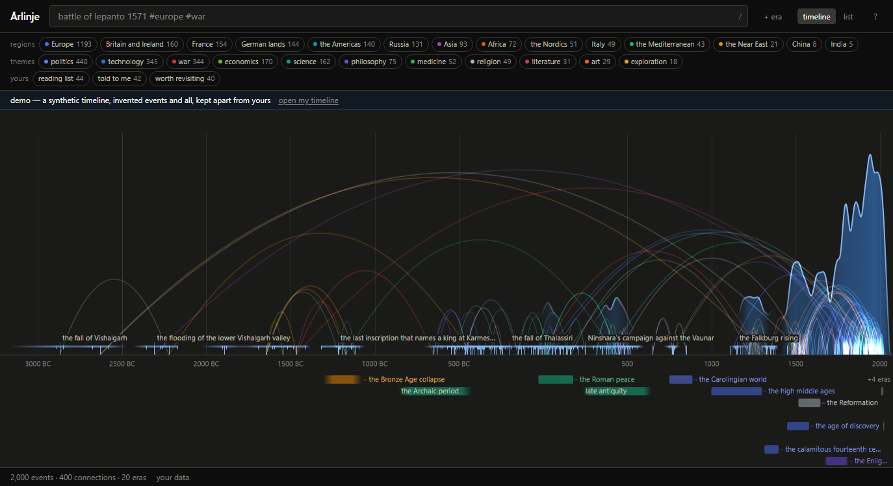

# Årlinje

A personal historical timeline: the events *you* have encountered — in books, conversations,
news, lectures — placed on a shared axis of time, and connected to each other.

*Årlinje* — year-line. The package and any ASCII-only contexts use `arlinje`.

**Live at [timeline.aslakhellevik.no](https://timeline.aslakhellevik.no)** — and
[`/?demo`](https://timeline.aslakhellevik.no/?demo) shows a full, synthetic one first.



Most timelines are canonical and impersonal: someone else decided what belongs on them. This
one is a record of an individual's accumulated historical knowledge. It grows as you read and
talk to people, and its shape says something about what you know and how you connect it. The
interesting content is not the events but the reasoning between them.

v1 is done: single user, local-first, no accounts, no server, an installable PWA that works
offline and on a phone. The technical decisions live in [docs/design.md](docs/design.md).

Built by Aslak Hellevik and Eivind Hjertholm, with Claude Code.

## Core concepts

### Events

The atomic unit: a title, a position in time (a date, a year, a range, or something fuzzier like
"mid-3rd century BC"), and optionally notes, tags, a place and sources. Adding an event is the act
of saying "I now know this happened."

So an event carries two times: **when it happened**, and **when you learned it** — alongside
*where you learned it from*. Both are free to record now and impossible to reconstruct later, and
they make the timeline replayable against your own life: not just what you know, but when each
piece of it arrived and what brought it.

### Connections

Two events can be connected. A connection is **an object in its own right**, not just an edge:
it has its own document — an argument for why these two things belong together. Some are causal,
some thematic, some ironic, some purely personal.

This is the part we think is actually novel. Connections are free-form — no taxonomy, just a
note — and stored as an ordered pair, so a later `caused` / `influenced` vocabulary can be
directional without a migration.

### Tags

Your own tags, plus a premade set: regions (Europe, the Near East, China…) and themes (war,
science, philosophy…). Type `#war` in the capture box and the event gets the built-in tag. Tags
drive filtering: view the timeline as art history only, or as Asia only.

### Eras

Named spans of time, drawn in lanes under the axis — canonical ones (the Cold War, the Warring
States period) or your own:

- your own life
- other people's lives
- "the years I was reading Russian novels"
- a family's history

Eras give the timeline a personal frame of reference — an event is not just in 1847, it is
*during your great-grandmother's childhood*. `+ era` in the header makes one over the middle of
whatever is on screen: zoom to the period you mean and press it.

## The graphical view

**Mass.** Zoomed out, events are not drawn individually. Periods dense with events show up as
*mass* — a visual weight proportional to how much you know about them. The timeline becomes a
density plot of your own historical knowledge, and its gaps are visible at a glance.

**Zooming in dissolves the mass** — first into tick marks, then into labels. It is one
continuous crossfade, and it runs **per column** rather than per frame: a single event alone in
400 BC resolves into a mark and a name while the twentieth century beside it is still a solid
hill. An event that lasted — `1914–1918` — draws its span as a bar over its tick.

Mass is a kernel density estimate whose bandwidth is measured in *pixels*, not years, so
zooming in genuinely resolves clumps into structure instead of stretching the same curve, and
uncertain events stay smeared while precise ones sharpen. The maths is in
[docs/design.md §3](docs/design.md#3-mass-d3).

**Connections** are drawn as arcs over the mass, coloured by tag, blending
additively so a bundle of them brightens where it crosses. Zoomed out, the connection structure
is the most striking thing on screen. Selecting an event dims every arc it does not touch.

**Tag filtering** changes what contributes mass, so switching from everything to *philosophy*
visibly redistributes the weight of the timeline — and removes weight rather than rescaling it,
so a thin subject stays thin.

Beside the timeline there is a **list**: everything, searchable and keyboard-navigable, over the
same filter. It is how you find things, and the accessible equivalent of the canvas.

## Starting from empty

A new timeline is empty, and that is the point: its shape is only a picture of what you know if
you put everything on it. First run asks one question — the year you were born — so the axis
has a "my life" era from the start; it can be skipped. Then the box at the top takes
`battle of lepanto 1571 #europe #war` and Enter.

For seeing a full one first, there is the demo ([Looking at it](#looking-at-it)), linked from
the first-run screen and from the empty timeline.

## Deferred

Not in v1. The data model is built so that none of these need a migration.

- **A social layer.** See a friend's timeline, the union or intersection with yours, and fork a
  connection with its explanation — copy with attribution. Records are already merge-ready
  (stable ids, timestamps, soft deletes). All events stay personal: two people adding "the fall
  of Constantinople" have two events.
- **AI.** Suggested tags on capture, and generating events from a book or a document. Every record
  carries provenance (`manual` or `import`) so that machine-made content can say so. Both mean
  sending your notes to someone else's API, which is a decision to make deliberately against the
  privacy default ([docs/design.md §7.9](docs/design.md#79-privacy-d25)), not inside a feature.

## Decisions

The summary; the rationale and the full log (D1–D71) are in [docs/design.md](docs/design.md#1-decision-log).

| Question | Decision |
|---|---|
| Time representation | One shape — a four-number fuzzy interval — edited as one text field. Numeric axis is fractional days, proleptic Gregorian, float64 |
| Mass rendering | Kernel density estimate, screen-space bandwidth, closed-form per event, semantic zoom per column |
| Event identity | All events personal; no canonical registry |
| Connection types | Free-form only, stored as an ordered pair |
| Views | One canvas — the timeline — plus a searchable, keyboard-navigable list, over one shared filter |
| Platform | Web app: Vite + TypeScript + React + Tailwind, PWA, installable, desktop and mobile |
| Local-first vs. server | Local-first; in-memory state, IndexedDB, versioned JSON export |
| Data durability | Three layers: persisted storage, automatic file backup, manual export |
| URL | Viewport, selection, tags and view live in the hash, so a period is a link |
| First run | One optional question, a birth year; a demo timeline in a database of its own |
| Privacy | No telemetry, no analytics, no network traffic beyond loading the app |
| Licence / language | MIT; UK English |

What is deliberately left open: [docs/design.md §9](docs/design.md#9-deliberately-left-open).

## Repo layout

```
docs/design.md      technical design and decision log
src/core/           pure, framework-free, fully tested
  model/            entities, ids, the built-in tag set
  time/             calendar, fuzzy intervals, parsing, formatting
  density/          the kernel density estimator
  testing/          seeded synthetic timeline generator (also the demo)
  filter.ts         the one filter predicate every view consumes
  search.ts         search, and the capture-time duplicate guard
  quick-add.ts      the capture grammar
  markdown.ts       a small Markdown subset, escape-first (D27)
src/render/         the canvas renderer — no framework imports (D11)
  timeline-renderer.ts  mass, marks, labels, axis, eras
  arcs.ts           connection arc geometry, colour and hit-testing
  lanes.ts          era lane allocation and bar geometry
src/state/          in-memory timeline, mutations, undo, persist queue
src/store/          IndexedDB, import/export and merge, backup, durability
src/ui/             React
scripts/pwa-plugin.ts  emits the manifest and service worker at build time
scripts/shot.mjs    screenshot the running app over CDP, for verification
wrangler.jsonc      the Cloudflare Worker that serves the build
```

`src/core` never imports from `src/ui` or `src/render`, and `src/render` never imports React.
That boundary is the one architectural rule worth enforcing — see
[D11](docs/design.md#1-decision-log).

```
npm run dev        # your timeline; starts empty
npm run demo       # a synthetic one, in its own database — opens /?demo
npm test           # 838 tests
npm run typecheck
npm run build      # dist/, with the service worker and manifest
```

## Looking at it

An empty timeline is the hardest possible thing to judge the app by, so there is a demo:
`npm run demo`, or `/?demo` on any running build. It opens a **separate database** filled with
the synthetic corpus the renderer was tuned against — 2,000 events, 400 connections and 20 eras,
every name invented — so nothing done in it can reach your real timeline, and backups are off
while it runs. A banner says so on every screen; "open my timeline" leaves it.

Things worth trying in it:

- **timeline** — scroll to zoom from five thousand years to a week; the mass dissolves into marks
  and then labels, column by column. Click a tag chip and watch the weight move.
- **an event** — click a mark, then `connect…` and pick a second event: the connection opens on
  its note, *why do these belong together*.
- **list** — everything, searchable; `?` shows the keyboard shortcuts.
- Type `battle of lepanto 1571 #europe #war` into the box at the top and press enter.

## Running it / deploying it

It is a static build served from a Cloudflare Worker with static assets, at
`timeline.aslakhellevik.no` (`wrangler.jsonc`). All paths in the build are relative, so `dist/`
also works from any other host or subdirectory — to run your own copy, change the route in
`wrangler.jsonc` or just serve `dist/` from anywhere.

```
npx wrangler login   # once per machine
npm run deploy       # build, then wrangler deploy
```

The service worker serves the HTML network-first, so a deploy reaches open tabs on their next
load, and a tab that is already open says `a new version is ready · reload`.
